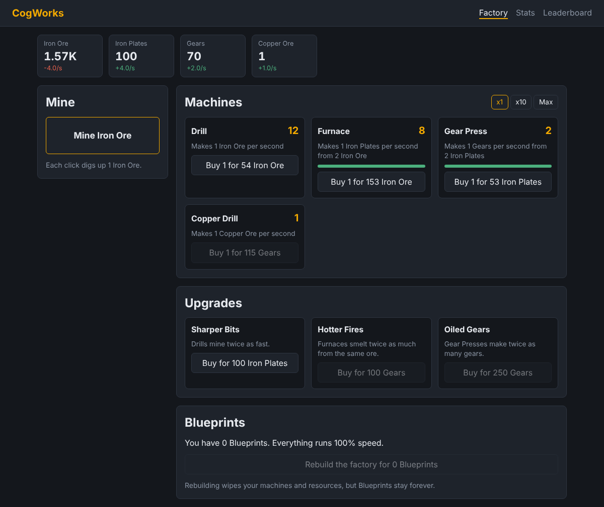

# CogWorks

An idle factory game that runs in the browser, built one small step at a time in C# and Blazor.

You start by mining iron ore by hand. Then you buy drills that mine for you, furnaces that turn ore into plates, presses that turn plates into gears, and it keeps growing from there: upgrades, a copper line, saving, offline progress, achievements, prestige and an online leaderboard.

*Design mockup. This is where the project is heading, not what exists yet.*

## Play it

Not online yet. The link goes here once the "Put it on the internet" milestone is done.

## How this repo works

This is the follow-along repo for a YouTube build series. Nothing is written in advance: every piece of the game is a [GitHub issue](../../issues), and every issue is broken into small steps, each with a short reason why.

The issues are numbered in the order to do them. Start at #1 and work up.

## Roadmap

Each milestone is a chunk of the game and roughly one video.

| # | Milestone | What gets built | What it teaches | Episode idea |
|---|-----------|-----------------|-----------------|--------------|
| 1 | Set up the workshop | Solution, Blazor project, empty page | .NET CLI, project structure, Git branches | *I'm building a factory game in C# (that runs in your browser)* |
| 2 | The first click | A number and a button that makes it go up | Razor syntax, events, CSS variables | Same video as 1: end on the first click |
| 3 | Model the game in C# | `Resource` and `Game` classes with tests | Classes, encapsulation, class libraries, unit tests | *Why I moved all my game code out of the page* |
| 4 | Machines and the game loop | Drills that mine on their own | Lists, `Math.Pow`, async loops, delta time | *My factory runs itself now* |
| 5 | Put it on the internet | Live link, automatic builds | GitHub Actions, CI, GitHub Pages | *You can play my game now* |
| 6 | Production chains | Furnaces, plates, gears, bottlenecks | Nullable types, algorithms, refactoring | *I added furnaces and immediately broke everything* |
| 7 | Components and layout | Reusable cards, grid layout, buy x10 | Blazor components, parameters, CSS grid, enums | *Making my game not look like a homework project* |
| 8 | Saving and offline progress | Your factory survives a refresh and works while you're away | Dictionaries, JSON, dependency injection, events | *My game plays itself while I sleep* |
| 9 | Upgrades and unlocks | Upgrades, locked machines, copper, circuits | Records, refactoring under tests, game balance | *I rewrote my machine system (and nothing broke)* |
| 10 | Stats, achievements and prestige | Stats page, achievements, Blueprints | Routing, delegates, events | *Adding the feature that makes idle games addictive* |
| 11 | Online leaderboard | A real backend with a database | ASP.NET Core Web API, EF Core, SQLite, CORS | *I built a backend for my browser game* |
| 12 | Launch | Polish, accessibility, v1.0 | Meta tags, accessibility, releases | *I finished my first real game* |

## Tech

- C# on .NET 10 (the current long-term support version; `global.json` pins it)
- Blazor WebAssembly for the game screen: C# for logic, HTML and CSS for the page
- xUnit for tests
- GitHub Actions and GitHub Pages for building and hosting
- Later: ASP.NET Core Web API, Entity Framework Core and SQLite for the leaderboard

## How to work through an issue

1. Open the lowest-numbered open issue.
2. Do the "Before you start" steps. Every issue gets its own branch.
3. Work down the steps, ticking each box as you go.
4. Do the "Check it works" section. Don't skip it.
5. Do the "Finish" steps: commit, push, open a pull request, merge it.
6. Move to the next issue.

Small branches that start from an up-to-date `main` and get merged quickly are also the easiest way to avoid merge conflicts.

## How the steps are written

- If a step uses C#, HTML or CSS you have seen before, it tells you **what** to write and you write it yourself. For example: "Add a property called `Id` of type `string`."
- If a step needs brand-new syntax, there is a short snippet. Type it out rather than pasting it. It sticks better.
- Every step has a **Why**. If the why doesn't make sense, stop and figure it out before moving on. That is the actual learning.

## Where things are

- [`docs/game-design.md`](docs/game-design.md): every number in the game (costs, rates, unlocks) and the colour palette.
- There is no code yet. Issue #2 creates the solution and #3 adds the first project.
